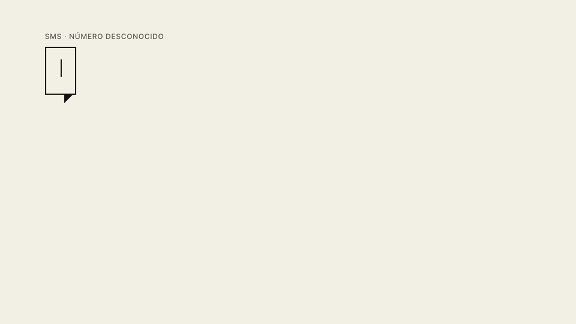

**Categoría: Tema libre** · #2 NaN Hackathon — Decide con Clef

# Legit?

[](docs/legit-30s.mp4)

<sub>30 s sin sonido. Con música: [docs/legit-30s.mp4](docs/legit-30s.mp4). Las respuestas de Clef que salen son las reales para ese mensaje (14 nov 2026).</sub>

Pegas el mensaje que te ha llegado (SMS, WhatsApp o correo) y en un segundo te dice si es una estafa, qué marca imita y qué hacer. Sin instalar nada, desde el móvil, en español y en inglés.

> «Parece Amazon, pero el enlace no es de Amazon. No pulses.»

Pensado para una persona mayor: un color (rojo, amarillo o verde: el verde es «no veo señales», no una garantía), tres preguntas con respuesta sí/no (¿te pide datos?, ¿dice ser alguien?, ¿el enlace es de verdad suyo?), una instrucción y un botón para que se lo lea en voz alta. Si duda, otro para enviárselo a un familiar.

## Cómo decide

1. **Clef decide (vía NaN).** Una sola petición con preguntas tipadas sobre el mensaje ([`lib/clef.js`](lib/clef.js)):

   | Pregunta | Tipo | Respuestas |
   |---|---|---|
   | ¿Pide datos, códigos o dinero? | `noul` | probabilidad de «sí» |
   | ¿Te manda llamar o escribir a un contacto que da? | `noul` | probabilidad de «sí» (estafas de «llama a este número», sin enlace) |
   | ¿De qué marca dice ser? | `choice` ×4 | 50 marcas: 30 globales y 20 de España y Latinoamérica, más «otra» y «ninguna» (una pregunta por grupo: Clef admite 26 opciones por pregunta). Cada dominio nuevo está verificado en Wikidata y/o en la web de la marca: ver [`lib/brands.js`](lib/brands.js) |
   | ¿Qué patrón de estafa sigue? | `choice` | banco, paquete, cuenta, premio, familiar en apuros, soporte técnico, inversión, ninguno |
   | ¿Cuánta presión mete? | `score` | de «ninguna» a «extrema» |

2. **El código comprueba lo que Clef no puede saber** ([`lib/links.js`](lib/links.js)): saca los enlaces y mira el dominio real con [`tldts`](https://www.npmjs.com/package/tldts) (`amazon.com.seguridad.xyz` es de `seguridad.xyz`), si es de verdad de esa marca ([`lib/brands.js`](lib/brands.js)), si la imita (`paypa1.com`, `bbva-clientes.com`, o mal escrita como `mcirosfot.com`), si mezcla letras de otro alfabeto, si es un acortador o una IP. Si el dominio es el nombre exacto de la marca con una terminación que no está en la lista (`netflix.co`), mira si su portada redirige al dominio oficial; si no, avisa en amarillo sin acusar.

3. **El veredicto sale de reglas** sobre esas respuestas, no de texto generado ([`lib/verdict.js`](lib/verdict.js)). Ejemplo: dice ser una marca, el enlace no es de esa marca y pide datos → rojo. Cada motivo es un código que la web traduce, y la web enseña las probabilidades de Clef en «Por qué».

Sin Clef no hay veredicto: es quien dice qué marca se está suplantando, y sin eso no hay nada contra lo que comprobar el enlace.

## Medición

### v2 — 14 nov 2026 · 60 mensajes nuevos · tras arreglar la regla de «hijo en apuros»

Resultado: [`eval/RESULTS-v2.md`](eval/RESULTS-v2.md). Conjunto: [`eval/cases-v2.jsonl`](eval/cases-v2.jsonl), fijado en git (commit `b5d8b58`) antes de medir y **sin ningún mensaje de la v1**. La regla se cambió mirando los fallos de la v1; por eso se mide con mensajes que nunca se vieron.

| | Estafas en rojo | Estafas en amarillo | **Estafas en verde (el error caro)** | Legítimos en verde | Legítimos en rojo |
|---|---|---|---|---|---|
| **Legit? con Clef** | 19/30 | 10/30 | **1/30** | 29/30 | 0/30 |
| Sin Clef (palabras clave) | 9/30 | 13/30 | 8/30 | 28/30 | 0/30 |

Mediana de latencia con Clef: 521 ms por mensaje.

- **«Hijo en apuros» (3 mensajes reales citados por Maldita.es):** 2 en amarillo con «llama a tu familiar a su número de siempre», 1 en verde. Sin Clef, los 3 salen en verde.
- **La que se escapa** (`md-hijo-01`, «Tengo un número temporal… ¿puedes enviar un mensaje de WhatsApp?»): Clef ve el patrón familiar (0,90) pero puntúa «te pide contactar» con 0,57, justo bajo el umbral de 0,6. Candidato a mejorar, que habrá que validar con un conjunto v3, no con este.
- **El legítimo en amarillo** (`uci2-07`) pregunta qué datos de cuenta hacen falta para una transferencia: el aviso es razonable.
- **Composición:** 21 de las 30 estafas son SMS bancarios de INCIBE (más fáciles: nombran el banco y piden verificar). La v2 no es más difícil que la v1, es distinta; no se puede leer «de 9 a 1» como mejora pura de la regla.
- Mismas limitaciones que la v1: legítimos informales en inglés y estafas sin enlace.

### v1 — 14 nov 2026 · 60 mensajes · una sola pasada

Resultado completo, caso por caso: [`eval/RESULTS.md`](eval/RESULTS.md). Conjunto: [`eval/cases.jsonl`](eval/cases.jsonl), fijado y guardado en git (commit `357988e`) **antes** de medir, con una regla escrita en su cabecera.

| | Estafas en rojo | Estafas en amarillo | **Estafas en verde (el error caro)** | Legítimos en verde | Legítimos en rojo |
|---|---|---|---|---|---|
| **Legit? con Clef** | 8/30 | 13/30 | **9/30** | 30/30 | 0/30 |
| Sin Clef (palabras clave) | 3/30 | 8/30 | 19/30 | 26/30 | 0/30 |

Mediana de latencia con Clef: 522 ms por mensaje.

**Qué dice:** con Clef, las estafas que pasan como «nada raro» bajan de 19 a 9 y ninguna conversación legítima sale en rojo ni en amarillo. Clef es la pieza que más aporta. **Pero 9 de 30 estafas reales salen en verde**, y eso es lo que hay que arreglar.

**Por qué fallan esas 9** (señales de Clef en [`eval/RESULTS.md`](eval/RESULTS.md)):

- **2 son «hijo en apuros»** (`ar-hijo-01`, `ar-hijo-02`). Clef las reconoce (patrón «familiar en apuros» 0,95 y 0,91; «te pide contactar» 0,95), pero es el primer mensaje del timo: todavía no pide dinero, y la regla solo pone rojo si pide algo. Es un fallo de las reglas, no de Clef, y el caso más importante para personas mayores.
- **4 eran mensajes con enlace al que la fuente le quitó el enlace** (terminan en «actualice:», «en la web:» o «XXXXXXXX»). Sin enlace no hay nada que comprobar; en la vida real el enlace estaría y entraría la comprobación de enlaces. No está medido.
- **3 son solo el asunto de un correo** (Netflix, FedEx, Amazon), sin el cuerpo.

**Limitaciones de este conjunto (léelas antes de citar la cifra):**

- Los 30 legítimos son SMS informales **en inglés** (UCI SMS Spam Collection) y las estafas están **en español**. El 0/30 de falsos avisos dice poco del caso difícil: avisos reales de banco, Correos o códigos de verificación en español. En pruebas sueltas, un código de verificación de Google sí sale en amarillo.
- INCIBE sustituye los enlaces de las estafas, así que **la comprobación de enlaces no se mide aquí**.
- n = 60. Es una indicación, no una tasa de error fiable.
- Los fallos se analizaron después de medir. Cualquier cambio de reglas a partir de ellos debe medirse con un conjunto **nuevo** (v2), no con este.

### La comprobación de enlaces, medida aparte (14 nov 2026)

Los dos conjuntos de arriba casi no tienen enlaces, así que el detector de imitaciones se mide con listas públicas, sin Clef ([`eval/links-check.mjs`](eval/links-check.mjs)):

| Lista | Resultado |
|---|---|
| 10.000 dominios más visitados ([Tranco](https://tranco-list.eu)) | **0** marcados como imitación. Antes de esta medición eran más de 100 (`cloud.com`, `telegraph.co.uk`, `correios.com.br`, `amazonaws.com`…): se corrigieron las reglas y se añadió una lista revisada, [`lib/popular.js`](lib/popular.js) |
| 100.000 más visitados | 170 marcados (0,17 %), sin revisar uno a uno: hay imitaciones reales y webs legítimas mezcladas |
| 45.387 enlaces de phishing activos y verificados ([PhishTank](https://phishtank.org), feed `online-valid` descargado el 14 nov 2026) | **3** pasan por «enlace de la marca» (una imagen de Bing, la portada de Bing y un perfil de TikTok). Antes de esta medición eran **402**: formularios de Microsoft, redirecciones de Google y Bing (`google.com/url?q=`, `/amp/`, `bing.com/ck`), Looker Studio, Google Cloud Storage, la API de bots de Telegram… Ahora esos dan amarillo («la página la puede crear cualquiera» o «el enlace te reenvía a otra web») |

Desglose de PhishTank tras el cambio: 5.350 (11,8 %) páginas de terceros dentro de una marca y 182 (0,4 %) redirecciones, que dan amarillo; 265 (0,6 %) imitaciones de marca; 2.303 (5,1 %) acortadores; 70 IP; **37.212 (82 %) dominios sin relación con ninguna marca**. En ese 82 % el enlace no dice nada por sí solo: hace falta que Clef diga qué marca dice ser el mensaje y qué pide.

Qué dice: el enlace por sí solo caza pocas estafas, pero casi no da por buena ninguna; el resto del trabajo es de Clef. Qué no dice: nada sobre mensajes completos. **Ojo:** las reglas de redirecciones salen de mirar este mismo feed. Para validarlas, se mide otra vez solo con enlaces enviados después del último de esta descarga (`2026-11-13T23:19:17`):

```bash
curl -sLo online-valid.csv http://data.phishtank.com/data/online-valid.csv
node eval/links-check.mjs phishing online-valid.csv 2026-11-13T23:19:17
```

No se usa OpenPhish: las condiciones de su feed gratuito no permiten usarlo para desarrollar productos.

### Cómo se mide

```bash
npm run eval:check          # valida el conjunto: 30 + 30, sin enlaces vivos ni datos personales
NAN_KEY=... npm run eval    # baseline (sin Clef) y Clef sobre los mismos mensajes -> eval/RESULTS.md
```

Cómo se recogen los casos: [`eval/README.md`](eval/README.md). `eval/tuning.jsonl` (12 mensajes escritos a mano) sirve para ajustar; `eval/cases.sample.jsonl` solo para probar el script. Ninguno cuenta para la cifra.

## Lo que no hace

- No detecta llamadas ni voces clonadas.
- No sustituye a tu banco.
- No comprueba números de teléfono ni abre los enlaces.
- No guarda los mensajes: se analizan en el servidor y no se escriben en disco ni en los logs. El veredicto se recuerda unos minutos en memoria, bajo un hash del texto, para no repetir la consulta si varias personas comprueban el mismo mensaje.
- Todavía no lee capturas de pantalla, solo texto.

## Ejecutarlo

```bash
npm install
NAN_KEY=tu-key npm run dev      # http://localhost:3000
npm test                        # tests de enlaces y reglas
```

Sin key se puede ver la interfaz con `CLEF_MOCK=1 npm run dev`: las respuestas son simuladas y la página lo avisa. No es Clef.

## Desplegar en Vercel

Importa el repo en Vercel (sin framework) y añade `NAN_KEY` en Settings → Environment Variables. La key solo vive en el servidor ([`api/check.js`](api/check.js)); el navegador nunca la ve. Si Clef responde `429` (una petición a la vez por key), la función espera un segundo y reintenta.

## Estructura

```
public/index.html   la web (una sola página, sin dependencias)
api/check.js        POST /api/check
lib/clef.js         las cuatro preguntas y la llamada a Clef
lib/links.js        extracción y comprobación de enlaces
lib/brands.js       marcas, dominios oficiales y acortadores
lib/verdict.js      reglas y umbrales
eval/run.mjs        medición con y sin Clef
eval/check-cases.mjs valida el conjunto de medición
```
